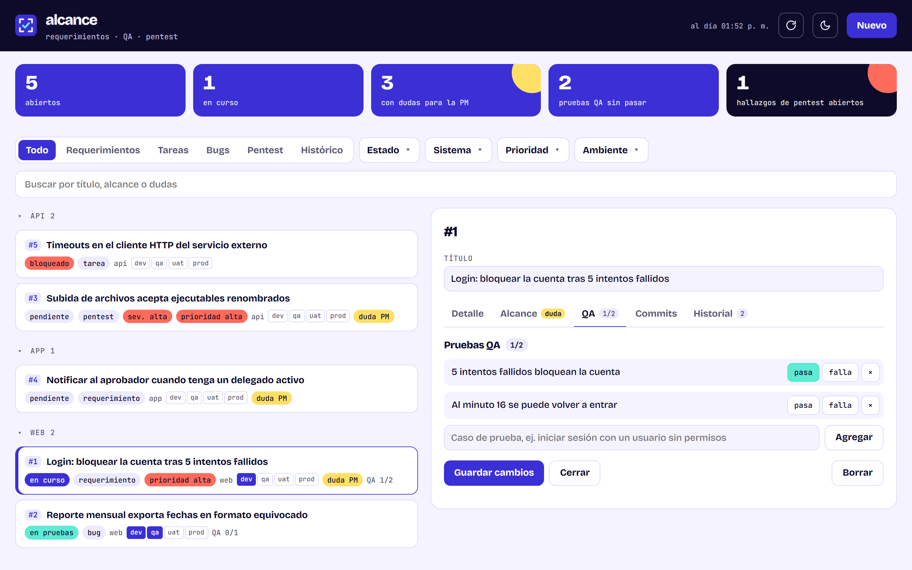
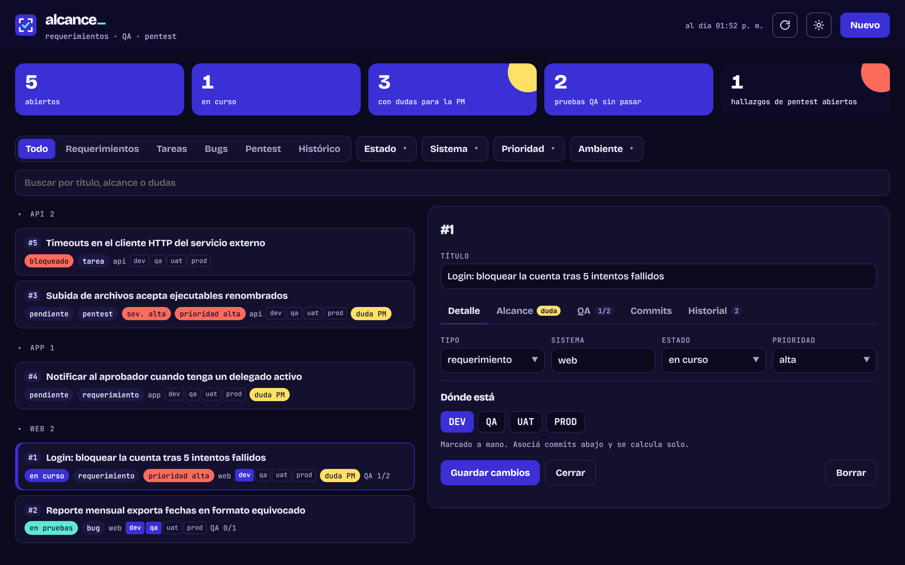

# alcance_

**Requirements, QA and pentest findings, tied to your git history.** A small local web app to keep the scope of every ticket written down, track what QA actually tested, and see in which environment each ticket already is, calculated from the branches that contain its commits. Spanish UI, runs 100% on your machine.



[Español abajo ↓](#español)

## What it does

- **Scope per ticket.** What is included, what is explicitly out, and the open questions for the PM (highlighted until they are answered).
- **QA checklist.** Test cases per ticket, marked as pass or fail, so nothing gets skipped silently.
- **Pentest findings** with severity, next to the rest of the work.
- **Environments from git.** Link commits to a ticket and Alcance tells you if it is already in `dev`, `qa`, `uat` or `prod`: a ticket is in an environment when all its commits reached that branch. Configurable branch → environment map.
- **Repo strip.** Current branch, uncommitted changes, unpushed commits and how many `develop` commits are still missing in each environment, for every repo in your folders.
- **Filters** by type, status, project, priority and environment ("in QA, not in prod yet"), with collapsible project groups.
- **History.** Every change is logged per ticket; closed tickets move to a paged *Histórico* with server-side search.
- **CLI for your assistant.** `node cli.mjs add|set|nota|prueba|commit|ls` writes straight to the database, so an AI coding assistant (or you) can keep tickets updated from the terminal while the UI refreshes on its own.



## Try it in one minute

Requires Node 24+ (uses the built-in `node:sqlite`) and git. No dependencies to install.

```bash
npm run demo     # sample tickets in .demo/, http://localhost:3221
```

The demo uses its own database and does not read your repos.

## Use it with your repos

```bash
cp repos.example.json repos.json   # list the folders that contain your repos
npm start                          # http://localhost:3220
```

`repos.json` stays on your machine (it is git-ignored). Without it the app works the same, just without the git part.

```bash
node cli.mjs add "Lock account after 5 failed logins" --tipo requerimiento --sistema web --prioridad alta --dudas "Per user or per IP?"
node cli.mjs commit 1 my-repo a1b2c3d     # links a commit; environments are calculated from git
node cli.mjs prueba 1 "5 failed attempts lock the account" ok
node cli.mjs set 1 --estado listo
```

## How it works

- `server.mjs` serves the UI and a small JSON API, only on `127.0.0.1`.
- `db.mjs` uses `node:sqlite` (`data/alcance.db`). The UI polls a cheap version fingerprint every 5 s and only downloads when something changed.
- `git.mjs` reads your repos with `git` (read-only: no fetch, no writes). The environment of each linked commit is stored and refreshed in the background only until it reaches `prod`.

```bash
npm test
```

---

## Español

**Requerimientos, QA y hallazgos de pentest, amarrados a tu historial de git.** Una app web local para dejar por escrito el alcance de cada ticket, llevar lo que QA de verdad probó y ver en qué ambiente está cada ticket, calculado de las ramas que contienen sus commits.

- **Alcance por ticket:** qué incluye, qué no, y las dudas para la PM.
- **Checklist de QA** con casos que pasan o fallan.
- **Hallazgos de pentest** con severidad.
- **Ambientes desde git:** un ticket está en un ambiente cuando todos sus commits ya llegaron a esa rama.
- **Franja de repos:** rama, cambios sin commit, lo que falta subir y lo que le falta a cada ambiente.
- **Filtros** por tipo, estado, proyecto, prioridad y ambiente, con grupos por proyecto que se pliegan.
- **Historial** de cambios por ticket e **Histórico** paginado de lo terminado.
- **CLI** para que tu asistente de código (o vos) actualice los tickets desde la terminal.

```bash
npm run demo                         # datos de ejemplo en http://localhost:3221
cp repos.example.json repos.json     # carpetas con tus repos
npm start                            # http://localhost:3220
```

Necesita Node 24+ y git. Sin dependencias.

## License

Apache-2.0. See [LICENSE](LICENSE) and [NOTICE](NOTICE). The JOTAPOL DEV name and logo are not covered by the license.
